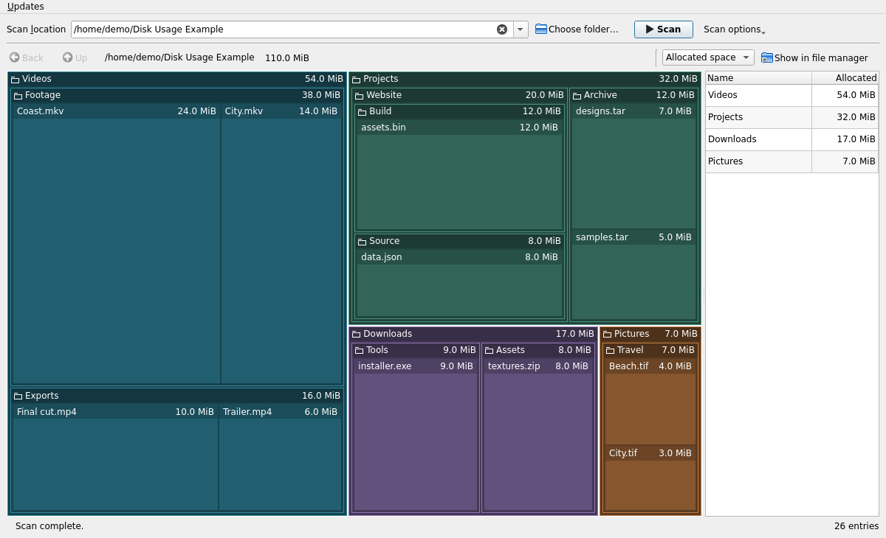

#  Disk-Diver

Disk-Diver zeigt, welche Ordner und Dateien auf einem lokalen Windows- oder Linux-Laufwerk Platz belegen. Wähle ein Laufwerk oder einen Startordner und starte den Scan. Die Rechteckflächen entsprechen dem belegten Speicher. Ein Klick wählt den Eintrag auch in der Liste aus. Ein Doppelklick auf einen Ordner zoomt hinein. Über **Im Dateimanager zeigen** gelangst du zum Fund.



Der **normale Scan** läuft mit deinen Benutzerrechten. **Erweiterte Rechte** öffnet eine Systemfreigabe für einen separaten Leseprozess. Der Dateimanager und das Hauptfenster behalten die normalen Rechte. Übersprungene oder unlesbare Einträge erscheinen in der Ansicht. Du kannst den Scan während der Auswertung abbrechen.

## Installieren

Unter Windows x64 den Installer `Disk-Diver-0.1.0-windows-x64.exe` ausführen und **Disk-Diver** im Startmenü öffnen. Der Installer bringt Qt und Python mit. Das Debian-Paket lässt sich mit `sudo apt install ./disk-diver_0.1.0_amd64.deb` installieren. Anschließend erscheint Disk-Diver im Anwendungsmenü.

## Bauen und starten

Für den Standard-Build werden Rust mit Cargo (getestet mit 1.93), CMake ab 3.22, ein C++20-Compiler, Qt 6 ab 6.2 mit Widgets und Python ab 3.10 benötigt. Linux verwendet zusätzlich Qt DBus. Ein Release-Build ist für Zeitmessungen wichtig.

**Windows** mit Visual Studio, Windows SDK und einem zum Compiler passenden Qt-SDK. Setze `QTDIR` auf das Qt-Präfix, beispielsweise den Ordner `msvc2022_64` deiner Installation.

```powershell
cmake -S . -B build -A x64 "-DCMAKE_PREFIX_PATH=$env:QTDIR"
cmake --build build --config Release --parallel
$env:Path = "$env:QTDIR\bin;$env:Path"
ctest --test-dir build -C Release --output-on-failure
.\build\bin\Release\disk-diver.exe
```

**Linux** mit Qt-Entwicklungspaketen, etwa `qt6-base-dev` unter Debian oder Ubuntu.

```sh
cmake -S . -B build -DCMAKE_BUILD_TYPE=Release
cmake --build build --parallel
ctest --test-dir build --output-on-failure
./build/bin/disk-diver
```

Das Programm startet aus dem Build-Verzeichnis im normalen Modus. Der Vollmodus verwendet eine systemweit geschützte Installation. Unter Windows müssen Anwendung, Scanner und Python unter **Program Files** installiert sein. Unter Linux gehören diese Dateien und ihre Verzeichnisse root und der Desktop benötigt einen polkit-Authentifizierungsagenten. Die Paketskripte unter [packaging](packaging/) erstellen eine Windows-Distribution mit Qt und Python sowie ein Debian-Paket.

Für ein eigenes Debian-Paket nach dem Release-Build `bash packaging/linux.sh build dist` ausführen. Dafür werden auch `dpkg-dev` und `qt6-qpa-plugins` benötigt. Der Windows-Paketbau verwendet Inno Setup 6 und das offizielle x64-Archiv der eingebetteten Python-Laufzeit. Paketversion, Download und Prüfsumme sind im [Build-Workflow](.github/workflows/build.yml) und im [Windows-Paketskript](packaging/windows.ps1) festgelegt.

## Größen und Aktualität

- **Logisch** entspricht der Länge der Datei. **Belegt** entspricht der vom Dateisystem ausgewiesenen Zuweisung. Bei einer Sparse-Datei können diese Werte stark voneinander abweichen. Die Summe umfasst die erfassten Dateien. Dateisystemverwaltung, reservierter Platz, Snapshots und gemeinsam genutzte Blöcke können die Laufwerksanzeige und den späteren Löschgewinn beeinflussen.
- Hardlinks bleiben unter allen Namen sichtbar. Innerhalb des gewählten Scanbereichs gehören ihre summierten Bytes zum lexikografisch ersten nativen Pfad. Symlinks, Junctions und untergeordnete Mounts führen den Scanner nicht aus dem gewählten Dateisystem.
- Der Scanner liest Metadaten. Ein Lauf auf einem aktiv beschriebenen Dateisystem erfasst ein Zeitintervall. Beim Wiederöffnen zeigt Disk-Diver den gespeicherten Stand samt Zeitpunkt. Stimmen die neu gelesenen Metadaten bytegenau überein, übernimmt die Oberfläche ihren bereits aufgebauten Index.
- Beide Cache-Arten speichern lokal. Im normalen Modus liegt SQLite unter `%LOCALAPPDATA%\disk-diver` beziehungsweise `$XDG_CACHE_HOME/disk-diver` (standardmäßig `~/.cache/disk-diver`). Vollscans verwenden eine eigene, nach Benutzer getrennte Ablage mit Admin-/Root-Zugriffsrechten. Der aktive Cache-Ordner wird bei einem übergeordneten Scan übersprungen. **Cache leeren** gilt für den gewählten Modus. Ein abgebrochener Lauf erhält den letzten abgeschlossenen Stand.

## Architektur und Sprachvergleich

Die Scanner in [C++](cpp/) und [Rust](rust/) implementieren dieselben Befehle. Windows liest gebündelte Verzeichnismetadaten, Linux verwendet verzeichnisrelative Metadatenabfragen. Beide liefern native Dateinamen, Identitäten, Größen und Fehler. Ein Index mit Eltern-IDs berechnet Ordnersummen und ordnet Hardlinks zu. Der Qt-Client bezieht denselben Datenstrom von beiden Scannern und berechnet die sichtbaren Zwischenergebnisse während des Einlesens. Das lokale Binärformat ist in [docs/protocol.md](docs/protocol.md) beschrieben.

Der Python-Worker koordiniert den nativen Prozess, Freigaben und Cache. Im gewöhnlichen Scan reicht er binäre Datenpakete durch und schreibt sie in einer SQLite-Transaktion. Beim vollständigen NTFS-Scan kann ein gültiges USN-Journal betroffene Verzeichnisse identifizieren. Der Worker liest deren Einträge erneut ein. Bei einer Lücke, mehrdeutigen Änderungen oder fehlender Unterstützung verwendet er den vollständigen Metadatenabgleich. Linux und frei gewählte Teilbäume werden beim Wiederöffnen direkt ab ihrer Wurzel überprüft.

**NTFS-Journal abgeglichen** bezeichnet den Stand der von Windows protokollierten Änderungen. Für bekannte offene Schreibvorgänge hält Disk-Diver die Leseposition bis zum Schließen der Datei zurück. War eine Datei bereits vor dem ältesten erhaltenen Journaleintrag zum Schreiben geöffnet, kann ihre letzte Größenänderung erst mit einem späteren Ereignis sichtbar werden. Für einen sofortigen vollständigen Metadatenabgleich lässt sich **Scan-Cache verwenden** ausschalten. [Microsoft zur Zusammenfassung offener Schreibvorgänge](https://learn.microsoft.com/en-us/windows/win32/fileio/change-journal-records)

**Rust ist der Standard für Windows und Linux.** Im Vergleich auf NTFS und ext4 hatte Rust in allen sechs Wertungsfällen die kürzere Medianlaufzeit. Auf Testvolumes mit jeweils gut einer Million Einträgen dauerte der warme Vollscan einschließlich Indexaufbau mit Rust **0,73 Sekunden unter Windows** und **2,37 Sekunden unter Linux**. Mit `-DDISK_DIVER_ENGINE=cpp` lässt sich derselbe Desktop mit dem C++-Vergleichskern bauen. [Messdaten und Methode](bench/README.md)

Die Scanner lassen sich unabhängig von Qt testen.

```sh
cmake -S . -B build-core -DDISK_DIVER_GUI=OFF -DDISK_DIVER_ENGINE=cpp -DCMAKE_BUILD_TYPE=Release
cmake --build build-core --config Release
cargo test --locked --manifest-path rust/Cargo.toml
cargo build --release --locked --manifest-path rust/Cargo.toml
```

Für einen JSON-Bericht rufe den jeweiligen Scanner mit `summary <Ordner>` auf. Der Windows-Befehl `layout <Laufwerkswurzel>` erprobt die volumenweite NTFS-Abfrage im Vollmodus. Im Test lieferten alle drei Verfahren dieselben 1.008.897 Einträge. Die volumenweite Abfrage brauchte beim Ausgeben der Metadaten im Median 3,65 Sekunden, die Rust-Verzeichnisabfrage 0,57 Sekunden. Deshalb bleibt der experimentelle Build-Schalter `DISK_DIVER_NTFS_LAYOUT` standardmäßig aus. [NTFS-Messreihe](bench/ntfs-layout.json)

Im [Benchmarkbericht](bench/README.md) stehen Befehle, Messdaten und die plattformübergreifende Auswahlregel. Ein vollständiger Lauf, ein kleiner Teilbaum, ein aktualisierter Cache und das Einlesen derselben Metadaten lassen sich separat messen.

## Mitwirken und Lizenz

Änderungen an der Größenberechnung gehören mit einem bekannten Sollwert in die Tests. Änderungen am Scanverfahren benötigen einen Release-Vergleich mit gleicher Baumstruktur, gleichem Cachezustand und gleichen Rechten. Fehlerberichte helfen mit Betriebssystem, Dateisystem, Scanmodus und einem kleinen reproduzierbaren Beispiel. Dateinamen aus privaten Scans können durch Beispieldaten ersetzt werden.

Die Vorlage für das App-Symbol ist [assets/disk-diver.svg](assets/disk-diver.svg). Nach einer Änderung erzeugt `python packaging/make_icons.py` mit `resvg-py==0.5.0` die PNG- und ICO-Dateien für die Desktop-App.

Disk-Diver steht unter **GPL-3.0-or-later**. Siehe [LICENSE](LICENSE) und [NOTICE](NOTICE).
